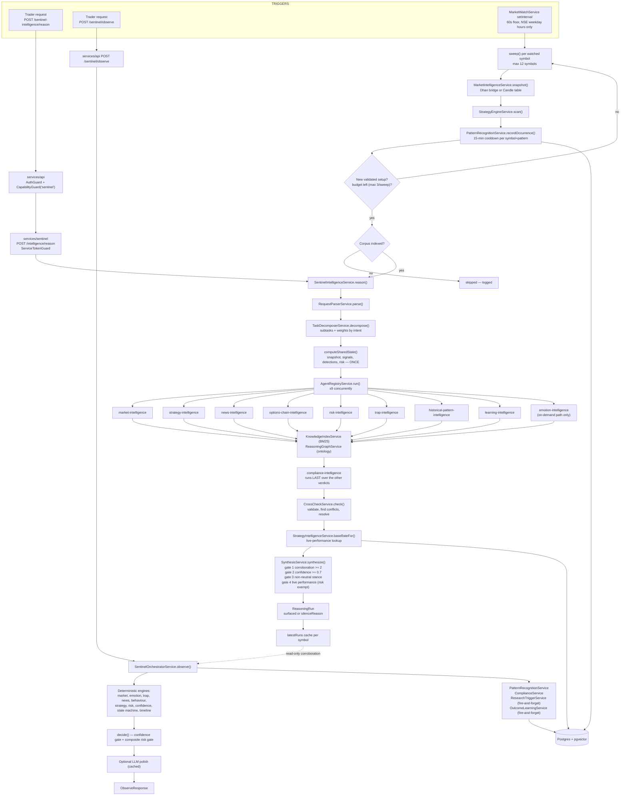
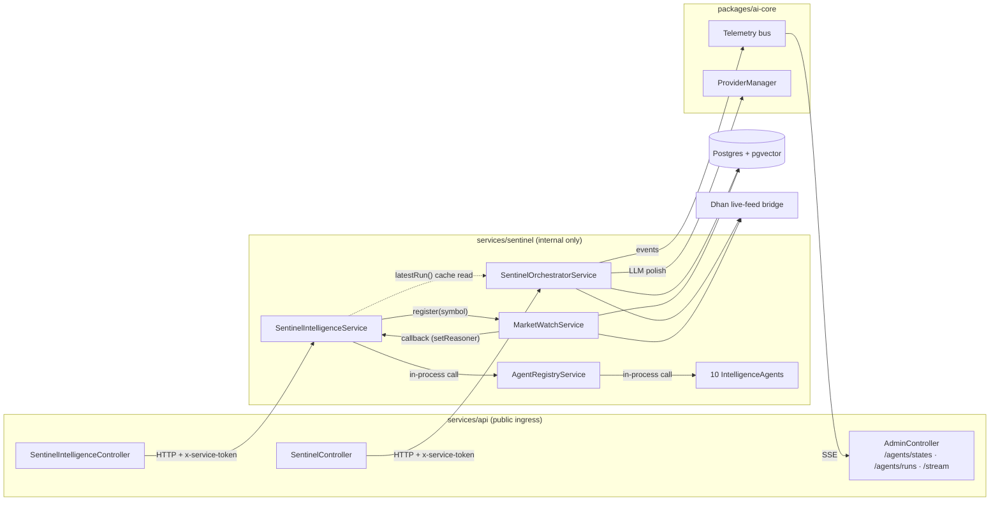

# TradeW — Canonical Agent Reference

> **Status:** evidence-based audit of the repository as it stands.
> **Scope:** every file under `services/`, `packages/`, `apps/`, `agents/`, `workflows/`, `docs/` (excluding `node_modules/`, `.git/`, `archive/`).
> **Rule applied throughout:** an agent is counted only when a class, a registration and an invocation path all exist in code. Design documents, declarative JSON that no loader reads, and services whose name contains "Intelligence" are *not* agents and are listed separately.
>
> This document describes **what the repository implements today**, not what the architecture documents intend.

---

## 0. The short answer

**How many agents can currently perform real work in real time?**

**Nine.** The nine SentinelIntelligence specialist agents that run on the background `MarketWatchService` sweep — `market-intelligence`, `strategy-intelligence`, `news-intelligence`, `options-chain-intelligence`, `risk-intelligence`, `trap-intelligence`, `historical-pattern-intelligence`, `learning-intelligence`, `compliance-intelligence` — execute without any human in the loop, once per 60-second sweep, during NSE trading hours.

Three qualifications that materially change what "real time" means here, all verified in code:

1. **Nothing runs until a human asks first.** `MarketWatchService` only sweeps symbols that were registered by a prior `POST /intelligence/reason` or `/intelligence/workspace` call (`sentinel-intelligence.service.ts:120`). With zero requests since boot, zero agents execute. Watches lapse 30 minutes after the last request (`SI_WATCH_TTL_MS`).
2. **Background reasoning is skipped on a cold corpus.** `reasonInBackground` returns `null` when the knowledge index is empty (`sentinel-intelligence.service.ts:195`), and the corpus is only indexed on the first `/reason` call because `indexOnBoot` defaults to `false` (`si.config.ts:203`).
3. **The cadence is a 60-second poll, not a stream.** `watchIntervalMs` is floored at 60 000 ms (`si.config.ts:208-211`), and at most **3** symbols per sweep may be reasoned about (`DEFAULT_WATCH_MAX_REASONING_PER_SWEEP = 3`). There is no tick-level, WebSocket or SSE path into any agent.

`emotion-intelligence` is the tenth agent. It is **on-demand only**: the background path supplies no `recentTrades`, and `TaskDecomposerService` skips the agent entirely when trade history is absent (`task-decomposer.service.ts:129-143`).

### Counts

| Category | Count | Members |
|---|---:|---|
| **Total implemented agents** (class + registration + invocation) | **10** | The ten `IntelligenceAgent` implementations |
| Real-time agents (continuous, tick-driven) | **0** | — |
| Event-driven agents (autonomous, 60 s watch sweep) | **9** | All except `emotion-intelligence` |
| On-demand agents (HTTP-triggered only) | **1** | `emotion-intelligence` (all 10 also run on the on-demand path) |
| Orchestrators | **2** | `SentinelOrchestratorService`, `SentinelIntelligenceService` |
| Planned agents (documented, no executable implementation) | **13 distinct**, named across 3 documents | 5 unwired `agents/sentinel/definitions.json` entries + 8 unwritten `agents/tradew-ai` definitions. The 10-agent `AGENT-ARCHITECTURE.md` roster is a naming layer over these and over already-implemented components (its own §4), so it adds no new agents. |
| Experimental agents | **0** | — |
| Deprecated / archived agents | **0** | No agent implementation exists in `archive/` |
| Mock agents | **0** | No agent returns hardcoded or fabricated output |

**Engineering agents** (Product Manager, Domain Expert, Product Designer, UI Designer, Backend Developer, Frontend Developer, Product Tester, Product Documenter): **none exist in this repository**, in any form — no code, no prompts, no n8n workflows, no configuration. See §8.

---

## 1. Layer map — what is an agent and what is not

```
                     TRIGGERS
   HTTP /observe        HTTP /intelligence/reason      MarketWatch 60s timer
          │                        │                            │
          ▼                        ▼                            ▼
 ┌──────────────────┐    ┌──────────────────────────────────────────────┐
 │  MANAGEMENT      │    │  SentinelOrchestratorService                 │
 │  (coordinate)    │    │  SentinelIntelligenceService                 │
 │                  │    │  ├─ RequestParserService   (understand)      │
 │                  │    │  ├─ TaskDecomposerService  (plan / route)    │
 │                  │    │  ├─ AgentRegistryService   (dispatch)        │
 │                  │    │  ├─ CrossCheckService      (validate)        │
 │                  │    │  └─ SynthesisService       (gate)            │
 └──────────────────┘    └──────────────────────────────────────────────┘
                                          │
                     ┌────────────────────┴───────────────────┐
                     ▼                                        ▼
 ┌──────────────────────────────────┐    (compliance runs LAST, over the
 │  WORKER / SPECIALIST AGENTS      │     other nine agents' text)
 │  market-intelligence             │
 │  strategy-intelligence           │
 │  news-intelligence               │
 │  options-chain-intelligence      │
 │  risk-intelligence               │
 │  emotion-intelligence            │
 │  trap-intelligence               │
 │  historical-pattern-intelligence │
 │  learning-intelligence           │
 │  compliance-intelligence         │
 └──────────────────────────────────┘
                     │  (agents READ only — no I/O of their own)
                     ▼
 ┌──────────────────────────────────────────────────────────────────────┐
 │  TOOLS / SERVICES / ENGINES                                          │
 │  MarketIntelligenceService · StrategyEngineService                   │
 │  TrapIntelligenceService · RiskIntelligenceService                   │
 │  NewsIntelligenceService · EmotionIntelligenceService                │
 │  KnowledgeIndexService (BM25 corpus) · ReasoningGraphService         │
 └──────────────────────────────────────────────────────────────────────┘
                     │
                     ▼
 ┌──────────────────────────────────────────────────────────────────────┐
 │  MEMORY / PERSISTENCE                                                │
 │  PrismaMemoryStore · PrismaKnowledgeGraph · ConceptGraphService      │
 │  PatternRecognitionService · OutcomeLearningService                  │
 │  StrategyIntelligenceService (base rates) · Postgres + pgvector      │
 └──────────────────────────────────────────────────────────────────────┘
                     │
                     ▼
                  RESULTS  (ReasoningRun / ObserveResponse)
```

**Critical distinction.** The ten specialist agents perform **reasoning work**: they read shared state, retrieve corpus passages, and emit a cited verdict. They perform **no data fetching, no persistence and no LLM calls** — verified: none of the ten has a constructor, none is `async`, and none references `prisma`, `fetch`, `http` or `process.env`. All I/O happens in the orchestration layer before the agents run.

---

## 2. Definitive agent inventory

### 2.1 The ten SentinelIntelligence specialist agents

All ten are found at `services/sentinel/src/sentinel-intelligence/agents/*.agent.ts`, all implement `IntelligenceAgent` (`agents/agent.contract.ts:54`), all are registered in `AgentRegistryService` (`agents/agent-registry.service.ts:42-53`) and provided in `SENTINEL_INTELLIGENCE_PROVIDERS` (`sentinel-intelligence.module.ts:88-98`), which `AppModule` spreads flat (`app.module.ts:274`).

| # | Agent ID | Class / file | Classification |
|---|---|---|---|
| 1 | `market-intelligence` | `MarketIntelligenceAgent` — `market-intelligence.agent.ts` | PRODUCTION_EVENT_DRIVEN |
| 2 | `strategy-intelligence` | `StrategyIntelligenceAgent` — `strategy-intelligence.agent.ts` | PRODUCTION_EVENT_DRIVEN |
| 3 | `news-intelligence` | `NewsIntelligenceAgent` — `news-intelligence.agent.ts` | PRODUCTION_EVENT_DRIVEN |
| 4 | `options-chain-intelligence` | `OptionsChainIntelligenceAgent` — `options-chain-intelligence.agent.ts` | PRODUCTION_EVENT_DRIVEN (conditional) |
| 5 | `risk-intelligence` | `RiskIntelligenceAgent` — `risk-intelligence.agent.ts` | PRODUCTION_EVENT_DRIVEN |
| 6 | `emotion-intelligence` | `EmotionIntelligenceAgent` — `emotion-intelligence.agent.ts` | PRODUCTION_ON_DEMAND |
| 7 | `trap-intelligence` | `TrapIntelligenceAgent` — `trap-intelligence.agent.ts` | PRODUCTION_EVENT_DRIVEN |
| 8 | `historical-pattern-intelligence` | `HistoricalPatternIntelligenceAgent` — `historical-pattern-intelligence.agent.ts` | PRODUCTION_EVENT_DRIVEN |
| 9 | `compliance-intelligence` | `ComplianceIntelligenceAgent` — `compliance-intelligence.agent.ts` | PRODUCTION_EVENT_DRIVEN |
| 10 | `learning-intelligence` | `LearningIntelligenceAgent` — `learning-intelligence.agent.ts` | PRODUCTION_EVENT_DRIVEN |

The canonical ID union is `AgentId` at `sentinel-intelligence/types.ts:162-172` — exactly these ten, with `ALL_AGENT_IDS` at line 174.

### 2.2 Orchestrators (2)

| Agent | File | Classification |
|---|---|---|
| `SentinelOrchestratorService` | `services/sentinel/src/orchestrator/sentinel-orchestrator.service.ts:97` | ORCHESTRATOR — PRODUCTION_ON_DEMAND |
| `SentinelIntelligenceService` | `services/sentinel/src/sentinel-intelligence/sentinel-intelligence.service.ts:63` | ORCHESTRATOR — PRODUCTION_ON_DEMAND + PRODUCTION_EVENT_DRIVEN |

These two run **in parallel and independently**. `SentinelOrchestratorService` owns `POST /observe`; `SentinelIntelligenceService` owns `POST /intelligence/reason`. The only coupling is one-directional and read-only: `SentinelOrchestratorService.decide()` reads `SentinelIntelligenceService.latestRun(symbol)` — the *already-computed cache* from the background watch — as corroboration. It never invokes the reasoning pipeline synchronously (`sentinel-orchestrator.service.ts:86-94`).

### 2.3 Planned agents (23) — documented, not executable

**(a) `agents/sentinel/definitions.json` — 5 declarative definitions, never loaded**

`market-technical`, `emotion`, `trap-safety`, `compliance-audit`, `orchestrator`.

Status **PLANNED**. `AgentDefinition[]` conforms to `packages/ai-core/src/agents/interfaces.ts:11`, but **no code anywhere reads this file**. The only runtime that could execute it, `DefaultAgentRuntime` (`packages/ai-core/src/agents/impl.ts:16`), is never instantiated in `services/`, `apps/` or `scripts/`. Its dependencies `DefaultToolRegistry` and `InMemoryPromptLibrary` are likewise never instantiated. The definitions' `systemPromptId` values (`sentinel.market-technical`, …) point at a Prompt Library that has no populated instance.

**(b) `agents/tradew-ai/` — 8 definitions, folder is empty**

`ai-researcher`, `company-analysis`, `news-analysis`, `option-chain-analysis`, `technical-analysis`, `strategy-builder`, `portfolio-insights`, `learning-assistant` (named in `agents/tradew-ai/README.md:3`).

Status **PLANNED**. The folder contains only `README.md`, which states "**Status:** empty". `services/tradew-ai/` contains only `README.md` — **zero TypeScript files**.

**(c) `docs/product-architecture/AGENT-ARCHITECTURE.md` — 10-agent roster**

Market, Research, News, Learning, Memory, Chart, Portfolio, Risk, Behavior, Sentinel agents.

Status **PLANNED**. The document's own header reads "Status: design, pre-implementation." It describes a `POST /agents/:name/invoke` contract — **no such route exists anywhere in the repository**. §4 of that document is explicit that this is "a conceptual/naming layer over agents that already exist", so these are not 10 additional runtime agents; they are aliases spanning the implemented Sentinel agents (Risk, Behavior, Sentinel), the Sentinel Brain services (Memory), and the unbuilt `services/tradew-ai` (the rest).

### 2.4 Not agents — commonly mistaken for them

| Name | What it actually is | Location |
|---|---|---|
| `MarketIntelligenceService`, `StrategyEngineService`, `TrapIntelligenceService`, `RiskIntelligenceService`, `NewsIntelligenceService`, `EmotionIntelligenceService`, `MarketBehaviourService` | Deterministic **intelligence engines**. Pure computation over candles/trades. Consumed by both orchestrators and handed to agents pre-computed. | `services/sentinel/src/intelligence/` |
| `ConceptLearningEngine`, `PrismaMemoryStore`, `PrismaKnowledgeGraph`, `KnowledgeCenterService` | **Memory systems** (Sentinel Brain). Postgres + pgvector backed. | `services/sentinel/src/brain/` |
| `HistoricalSimilarityService`, `MarketContextService`, `OutcomeLearningService`, `PatternRecognitionService`, `ResearchTriggerService`, `StrategyIntelligenceService` (brain) | **Supporting services** over the memory layer. Called by the orchestrator, never by an agent. | `services/sentinel/src/brain/` |
| `ConfidenceEngine`, `MarketTimelineEngine`, `MarketStateMachineService` | **Engines** in the `/observe` pipeline. | `services/sentinel/src/{confidence,timeline,state-machine}/` |
| `KnowledgeIndexService`, `ReasoningGraphService`, `CorpusIngestionService`, `CorpusScannerService` | **Knowledge substrate** (BM25 index + concept ontology). The two "tools" agents can call. | `services/sentinel/src/sentinel-intelligence/knowledge/` |
| `RequestParserService`, `TaskDecomposerService`, `AgentRegistryService`, `CrossCheckService`, `SynthesisService` | **Orchestration components**, not agents. They plan, dispatch, validate and gate. | `services/sentinel/src/sentinel-intelligence/` |
| `MarketWatchService` | **Scheduler / trigger**. A `setInterval` sweep. Does not reason. | `sentinel-intelligence/watch/market-watch.service.ts` |
| `market-technical`, `emotion`, `trap-safety`, `news`, `orchestrator`, `compliance-audit` (in `/observe`) | **Telemetry labels**, not classes. Strings passed to `trackAgent()` / `emitAgentActivity()` so the admin orbit can render engine activity. | `sentinel-orchestrator.service.ts:199-331` |
| `SignalAgent` union (`market-technical`, `emotion`, `trap-safety`, `strategy`, `risk`) | **Provenance tag** on a `Signal`, naming which engine produced it. | `services/sentinel/src/domain.ts:11-16` |

---

## 3. Agent-by-agent trace

Common to **all ten** agents (verified by grep across `agents/*.agent.ts`):

- **Model:** none. Every agent is fully deterministic. No LLM is invoked on any agent path.
- **System prompt:** none. Agents are code, not prompts. (`si.config.ts` comment at `market-watch.service.ts:133`: "The pipeline is fully deterministic — no LLM on any path".)
- **Registration:** `AgentRegistryService` constructor → `Map<AgentId, IntelligenceAgent>` (`agent-registry.service.ts:42`).
- **Invocation path (on demand):**
  `services/api POST /sentinel-intelligence/reason` → `SentinelIntelligenceApiService` → `services/sentinel POST /intelligence/reason` → `SentinelIntelligenceController.reason` → `SentinelIntelligenceService.reason()` → `runAgents()` → `AgentRegistryService.run()` → `agent.reason(context)`
- **Invocation path (event-driven):**
  `MarketWatchService.sweep()` → `watchOne()` → `WatchReasoner` callback → `SentinelIntelligenceService.reasonInBackground()` → `reason()` → `runAgents()` → `AgentRegistryService.run()` → `agent.reason(context)`
- **Inputs:** an `AgentContext` (`agent.contract.ts:33`) — `understood`, `subtask`, `snapshot`, `signals`, `detections`, `risk`, `trades`, `account`, `index`, `graph`, `at`.
- **Outputs:** one `AgentVerdict` (`types.ts`), built through `VerdictBuilder` — stance, confidence, headline, evidence[], supportingConcepts[], citations[], abstained, dataQuality, latencyMs.
- **Memory:** none directly. Agents read the in-memory BM25 corpus (`KnowledgeIndexService`) and the concept ontology (`ReasoningGraphService`). No agent touches Postgres.
- **Database access:** none. No `PrismaService` injection in any agent.
- **Permissions:** read-only over the context object. No filesystem, no network, no broker API, no order placement.
- **Safety restrictions:** `CORE_GUARDRAILS` are irrelevant here (no LLM). The enforced boundary is `enforceVocabulary()` / `hasDirectiveLanguage()` (`services/sentinel/src/vocabulary/vocabulary.ts`), applied by `ComplianceIntelligenceAgent` and by `CrossCheckService.validate()`.
- **Failure behaviour:** a thrown agent becomes a zero-confidence abstention with the error text preserved, never a failed run (`agent-registry.service.ts:75-81`).
- **Tests:** **none of the ten agents has a dedicated spec file.** See §16.
- **Execution mode:** synchronous; the nine non-compliance agents run concurrently via `Promise.all`, compliance runs last and serially (`sentinel-intelligence.service.ts:357-368`).

### 3.1 `market-intelligence`

| Field | Value |
|---|---|
| Purpose | Structure, regime and indicator posture for the symbol in focus. |
| Remit (code) | `'Structure, regime and indicator posture for the symbol in focus.'` |
| Code | `services/sentinel/src/sentinel-intelligence/agents/market-intelligence.agent.ts:25` |
| Entry point | `reason(context): AgentVerdict` (line 28) |
| Reads from context | `snapshot`, `signals`, `understood.market`, `understood.timeframe` |
| Tools | `gatherCitations` (BM25), `gatherConcepts` (ontology), `triggeredFrom(signals,'market-technical')` |
| Upstream data | `MarketIntelligenceService.snapshot()` + `.signals()`, computed once by the engine |
| Agents it calls | none |
| Agents that call it | none — every other subtask lists it as `dependsOn` for readability only (`task-decomposer.service.ts:60`) |
| Real-time | YES — event-driven (60 s sweep) and on-demand |
| Weight | 1.0 on `market-read`, `visual-workspace`, `unknown`; 0.5–0.85 elsewhere |
| Limitations | Abstains when `snapshot` is null (market-data outage → HTTP 503 upstream). No tests. |

### 3.2 `strategy-intelligence`

| Field | Value |
|---|---|
| Purpose | Whether learned strategy rules confirm, partially confirm, or invalidate on live structure. |
| Code | `.../agents/strategy-intelligence.agent.ts:31` |
| Reads | `detections`, `snapshot`, `understood.market`, `understood.strategyIds` |
| Upstream | `StrategyEngineService.scan(snapshot, at)` — declarative, book-derived rules |
| Real-time | YES — event-driven + on-demand |
| Weight | 1.0 on `strategy-check` |
| Limitations | Depends entirely on `StrategyEngineService` detections; no independent rule evaluation. No tests. |

### 3.3 `news-intelligence`

| Field | Value |
|---|---|
| Purpose | Whether news or a scheduled event changes how current structure should be read. |
| Code | `.../agents/news-intelligence.agent.ts:31` |
| Reads | `signals.find(...)` — news signals pre-fetched by the engine |
| Upstream | `NewsIntelligenceService.signals(symbol)` — **the only network-reaching input**, wrapped in try/catch at `sentinel-intelligence.service.ts:316-320`; failure is non-fatal and degrades this agent to a thin read |
| Notes | `NewsIntelligenceService` internally uses `NewsEventClassifier` with an LLM (`news-intelligence.service.ts:78`) — but that happens **before** the agent runs, in the shared-state phase, not inside the agent |
| Real-time | YES — event-driven + on-demand |
| Limitations | No tests. Emits under the `market-technical` `SignalAgent` tag (noted in the file's own header comment), which makes news signals hard to attribute. |

### 3.4 `options-chain-intelligence`

| Field | Value |
|---|---|
| Purpose | OI walls, put-call ratio, max-pain pin, and the strike in focus. |
| Code | `.../agents/options-chain-intelligence.agent.ts:33` |
| Reads | `snapshot` (option chain), `understood.market`, `understood.strike`, `understood.right` |
| Registration/dispatch | Subtask is created **only** when `understood.market.hasOptionChain` is true; otherwise the decomposer records an explicit skip (`task-decomposer.service.ts:82-99`) |
| Real-time | YES — event-driven + on-demand, **conditional on the instrument having a chain** |
| Weight | 1.0 on `option-context` |
| Limitations | No tests. Silent on equities without listed options (correctly recorded as a skip, not an all-clear). |

### 3.5 `risk-intelligence`

| Field | Value |
|---|---|
| Purpose | The risk environment, scored against the trader's stated profile and style. |
| Code | `.../agents/risk-intelligence.agent.ts:30` |
| Reads | `risk` (a `RiskAssessment`), `snapshot`, `account`, `understood.riskProfile`, `understood.style` |
| Upstream | `RiskIntelligenceService.assess(snapshot, signals, account, at)` |
| Real-time | YES — event-driven + on-demand |
| Notes | On the background path `account` is `undefined` by construction, so risk is read market-wide rather than against a book (`sentinel-intelligence.service.ts:200-206`) |
| Weight | 1.0 on `risk-review` |
| Gate exemption | `risk-elevated` stances are **exempt from the live-performance gate** — a risk warning matters without a track record (`si.config.ts:91-99`) |
| Limitations | No tests. |

### 3.6 `emotion-intelligence`

| Field | Value |
|---|---|
| Purpose | Behavioural patterns in the trader's own recent activity — reflective, never judgemental. |
| Code | `.../agents/emotion-intelligence.agent.ts:32` |
| Reads | `trades`, `signals` (via `triggeredFrom(signals,'emotion')`) |
| Upstream | `EmotionIntelligenceService.signals(trades)` |
| Dispatch condition | Subtask created **only** when `request.recentTrades.length > 0` (`task-decomposer.service.ts:129-143`) |
| Real-time | **NO for the background path** — `reasonInBackground` constructs a `ReasonRequest` with no `recentTrades` and no `account`, so this agent is always skipped there. YES on demand. |
| Classification | PRODUCTION_ON_DEMAND |
| Weight | 1.0 on `behaviour-review` |
| Limitations | No tests. Depends on the caller supplying trade history; `services/api` must pass it through. |

### 3.7 `trap-intelligence`

| Field | Value |
|---|---|
| Purpose | Composite trap signatures — liquidity sweeps, failed breakouts, expiry and low-participation traps. |
| Code | `.../agents/trap-intelligence.agent.ts:29` |
| Reads | `signals`, `snapshot`, plus `graph.detect(...)` and `graph.tensionsAmong(...)` — the only agent using the ontology's conflict-detection surface |
| Upstream | `TrapIntelligenceService.signals(snapshot, trades)` |
| Real-time | YES — event-driven + on-demand |
| Limitations | No tests. |

### 3.8 `historical-pattern-intelligence`

| Field | Value |
|---|---|
| Purpose | Whether comparable structure has occurred before in the available history, and what followed. |
| Code | `.../agents/historical-pattern-intelligence.agent.ts:48` |
| Reads | `snapshot.candles` **only** |
| Memory | **None.** The file's own header (lines 34-45) states the choice explicitly: it computes self-similarity over the candles in hand rather than reading the Brain's Postgres pattern tables, so it never abstains for infrastructure reasons. |
| Abstention | When `candles.length < WINDOW + HORIZON + MIN_SAMPLE` |
| Real-time | YES — event-driven + on-demand |
| Limitations | The accumulated live track record in `PatternRecognitionService` / `StrategyIntelligenceService` is **not** visible to this agent — only to the gate. Weaker evidence than the system already holds. No tests. |

### 3.9 `compliance-intelligence`

| Field | Value |
|---|---|
| Purpose | Audits every other agent's output for directive language and records the observation-only boundary. |
| Code | `.../agents/compliance-intelligence.agent.ts:26` |
| Inputs | Injected via `withText(string[])` (line 39) — the headlines and evidence statements of the nine non-abstaining agents, pushed by `SentinelIntelligenceService.runAgents()` (line 366) |
| Tools | `enforceVocabulary`, `hasDirectiveLanguage` (`services/sentinel/src/vocabulary/vocabulary.ts`), `gatherCitations` |
| Execution mode | **Serial and last** — the only ordering constraint in the pipeline |
| Output | `risk-elevated` at 0.9 confidence when directive vocabulary survives enforcement; otherwise `neutral` |
| Real-time | YES — event-driven + on-demand (runs unconditionally on every run) |
| Limitations | **It reports; it does not block.** A `risk-elevated` compliance verdict is one weighted verdict among ten — it does not veto surfacing. No tests. See gap CG-2. |

### 3.10 `learning-intelligence`

| Field | Value |
|---|---|
| Purpose | The concepts and source passages that explain the current situation. Educational only. |
| Code | `.../agents/learning-intelligence.agent.ts:27` |
| Reads | `detections`, `snapshot`, `understood.indicators`, `understood.rawText`, `graph.explainerFor(...)` |
| Real-time | YES — event-driven + on-demand (runs unconditionally) |
| Limitations | No tests. Produces nothing useful when the corpus is unindexed. |

### 3.11 `SentinelOrchestratorService` — ORCHESTRATOR

| Field | Value |
|---|---|
| Purpose | The only component that produces user-facing copy on the `/observe` path. Runs the Master Plan workflow and decides whether anything is worth saying. |
| Code | `services/sentinel/src/orchestrator/sentinel-orchestrator.service.ts:97` |
| Entry point | `observe(request): Promise<ObserveResponse>` (line 164) |
| Registration | `app.module.ts:201` (flat provider) |
| Invocation | `apps/web useSentinel()` → `services/api POST /sentinel/observe` → `services/sentinel POST /observe` (`app.controller.ts:89`) → `orchestrator.observe()` |
| Model | Optional LLM polish only — `providers.getLlm().complete()` at line 844-845, via `createProviderManager(loadProvidersConfigFromEnv())`. With no provider configured a deterministic template produces the same structure. |
| Tools | 22 injected services (lines 122-143): market/emotion/trap/news/behaviour engines, strategy lifecycle, adaptive calibration, confidence engine, state machine, timeline, compliance, explain, pattern recognition, historical similarity, market context, research trigger, outcome learning, strategy advisor, regime intelligence, and `SentinelIntelligenceService` |
| Memory | Writes: `PatternRecognitionService.recordOccurrence()` per triggered signal (line 300), `ComplianceService.record()` (line 345). Reads: historical similarity, market context, Brain base rates. |
| Fire-and-forget | `ResearchTriggerService.researchIfUnfamiliar()` and `OutcomeLearningService.evaluatePending(5)` (lines 187-190) |
| Real-time | YES — on-demand only. No scheduler drives `/observe`; `apps/web` calls it on mount and on symbol change, with **no polling interval**. |
| Gates | Confidence gate (trader threshold) + composite risk gate (`SURFACE_THRESHOLD = 0.7`) |
| Observability | `runAgentRun()` opens an `AgentRun` row and ambient telemetry context; `trackAgent()` wraps each engine call |
| Tests | `orchestrator/cross-validation.spec.ts`, `institutional-cross-validation.spec.ts`, `publication-gate.spec.ts` — **pure helper functions only**. The service class itself is untested. |
| Safety | Never places orders. Every generated string passes `enforceVocabulary`. |

### 3.12 `SentinelIntelligenceService` — ORCHESTRATOR

| Field | Value |
|---|---|
| Purpose | Master reasoning engine: understand → decompose → compute shared state once → run ten agents → validate → cross-check → live-performance lookup → synthesize → gate. |
| Code | `services/sentinel/src/sentinel-intelligence/sentinel-intelligence.service.ts:63` |
| Entry points | `reason(request, opts)` (line 98); `reasonInBackground(symbol, snapshot, at)` (line 190, private, wired via `onModuleInit` setter at line 172) |
| Registration | `SENTINEL_INTELLIGENCE_PROVIDERS` (`sentinel-intelligence.module.ts:112`) → `app.module.ts:274` |
| HTTP | `POST /intelligence/reason`, `/workspace`, `/rules`, `/reindex`, `GET /intelligence/status`, `/rules` — all behind `ServiceTokenGuard` (`sentinel-intelligence.controller.ts:31`) |
| Public route | `services/api` `POST /sentinel-intelligence/reason` — `AuthGuard` + `CapabilityGuard` + `@RequiresCapability('sentinel')` + `@Throttle(EXPENSIVE_LIMIT)`, metered via `entitlements.recordUsage(...,'sentinel_requests')` |
| Model | **None.** Fully deterministic on every path. |
| Memory | Reads `StrategyIntelligenceService.baseRateFor(pattern)` for the live-performance gate (line 255). Holds `latestRuns: Map<symbol, ReasoningRun>` capped at `watchMaxSymbols` (line 228). Persists nothing itself. |
| Real-time | YES — event-driven (watch) + on-demand (HTTP) |
| Gates | corroboration ≥ 2 non-abstaining agents → confidence ≥ 0.7 → non-neutral stance → live-performance for directional reads |
| Tests | `synthesis/gate.spec.ts`, `understanding/request-parser.spec.ts`, `knowledge/knowledge-index.spec.ts`, `watch/market-watch.spec.ts` — the service class itself is untested end-to-end. |

---

## 4. Real-Time Agent Force

> "If TradeW is running right now, which agents can actually do useful work right now?"

**Precondition for any of it:** `SI_WATCH_ENABLED != 'false'` (default on), at least one symbol registered by a request in the last 30 minutes, NSE weekday trading hours, and a warm corpus.

| Agent | Trigger | Input | Processing | Output | Latency | Dependencies | Failure behaviour |
|---|---|---|---|---|---|---|---|
| `market-intelligence` | Watch sweep finds a *new* validated detection (cooldown-cleared) | Shared snapshot, market signals | Structure/regime read; corpus retrieval | `AgentVerdict` | Sub-ms CPU (in-memory BM25); no metered HTTP — the sweep's snapshot is reused | `MarketIntelligenceService`, `KnowledgeIndexService` | Abstains on null snapshot |
| `strategy-intelligence` | same | Detections, snapshot | Rule confirmation read | `AgentVerdict` | same | `StrategyEngineService` | Abstains on no detections |
| `news-intelligence` | same | Pre-fetched news signals | Event-context read | `AgentVerdict` | same | `NewsIntelligenceService` (network, non-fatal) | Thin verdict if the newswire failed |
| `options-chain-intelligence` | same, **if** the instrument has a chain | Snapshot option chain | OI / PCR / max-pain read | `AgentVerdict` | same | Chain data in snapshot | Skipped by the decomposer with a recorded reason |
| `risk-intelligence` | same | `RiskAssessment`, snapshot | Profile-scored risk read | `AgentVerdict` | same | `RiskIntelligenceService` | Abstains on null snapshot |
| `trap-intelligence` | same | Trap signals, ontology | Composite trap read | `AgentVerdict` | same | `TrapIntelligenceService`, `ReasoningGraphService` | Abstains on null snapshot |
| `historical-pattern-intelligence` | same | `snapshot.candles` | Self-similarity base rate | `AgentVerdict` | same | Candle depth only | Abstains when history is too short |
| `learning-intelligence` | same (unconditional) | Corpus + ontology | Concept explainer | `AgentVerdict` | same | `KnowledgeIndexService`, `ReasoningGraphService` | Weak grounding on cold corpus |
| `compliance-intelligence` | same (unconditional, last) | Other nine agents' text | Vocabulary audit | `AgentVerdict` | same | `vocabulary.ts` | Neutral verdict when no text was produced |

**Not in the real-time force:** `emotion-intelligence` (no trade history on the background path), `SentinelOrchestratorService` (`/observe` is human-triggered only).

### 4.1 Actual runtime flow



---

## 5. Execution lifecycle (as implemented)

```
TRIGGER
  ├─ HTTP POST /sentinel-intelligence/reason  (human)
  ├─ HTTP POST /sentinel/observe              (human)
  └─ MarketWatchService setInterval           (autonomous, 60s)
      ↓
GUARDS
  services/api: AuthGuard → CapabilityGuard('sentinel') → Throttle(EXPENSIVE_LIMIT)
  services/sentinel: ServiceTokenGuard (constant-time, fails closed on weak token)
      ↓
CORPUS WARM-UP  (ensureCorpus — lazy, first /reason pays for it)
      ↓
UNDERSTAND       RequestParserService.parse()  → UnderstoodRequest (intent, symbol, timeframe, strike…)
      ↓
DECOMPOSE        TaskDecomposerService.decompose() → Subtask[] + skipped[] + per-intent weights
      ↓
SHARED STATE     computeSharedState() — ONE snapshot fetch, engines run once
                 (background path reuses the sweep's snapshot: zero extra metered HTTP)
      ↓
AGENT EXECUTION  AgentRegistryService.run() — 9 concurrent, compliance serial-last
      ↓
TOOL EXECUTION   gatherCitations() → KnowledgeIndexService.search()
                 gatherConcepts()  → ReasoningGraphService.supportFor()
      ↓
VALIDATION       CrossCheckService.check() — reject uncited knowledge claims,
                 detect directive language, find + resolve conflicts, compute penalty
      ↓
MEMORY LOOKUP    StrategyIntelligenceService.baseRateFor(pattern)  (read-only)
      ↓
SYNTHESIS+GATE   SynthesisService.synthesize() — 4 gates, silence is the designed outcome
      ↓
OUTPUT           ReasoningRun (full plan, every verdict, every citation, every conflict)
      ↓
MEMORY UPDATE    (background path only) MarketWatchService → PatternRecognitionService.recordOccurrence()
                 (/observe path)        PatternRecognitionService + ComplianceService.record()
```

**Deviation from the canonical lifecycle in the brief:** memory update happens **before** agent execution on the watch path (the sweep records the occurrence, then reasons) and **after** synthesis on the `/observe` path. The reasoning pipeline itself writes nothing.

---

## 6. Agent communication

| Mechanism | Used? | Where |
|---|---|---|
| Direct function calls (in-process DI) | **YES — the only mechanism between agents** | `AgentRegistryService.run()` → `agent.reason(context)` |
| Shared immutable state object | **YES** | `AgentContext`, computed once per run |
| Setter injection (one-off) | **YES** | `ComplianceIntelligenceAgent.withText()` — the only cross-agent data flow |
| HTTP (service→service) | YES, but **between services, not agents** | `services/api` → `services/sentinel` with `x-service-token` |
| Event bus | Telemetry only, one-way | `packages/ai-core/src/telemetry/bus.ts` → admin SSE `/admin/stream` |
| Message queue | **NO** | — |
| n8n | **NO** | `workflows/` contains only a README; "no exports exist yet" |
| Database as a channel | Indirect only | Both orchestrators write occurrences to the same Brain store |
| Shared memory cache | **YES, one-way** | `SentinelIntelligenceService.latestRuns` read by `SentinelOrchestratorService.decide()` |

**Synchrony:** agent-to-agent communication is **synchronous and in-process**. The nine non-compliance agents run **concurrently** (`Promise.all`); compliance runs **serially, last**. Nothing streams. The only asynchronous surfaces are the telemetry SSE stream and the two fire-and-forget Brain calls in `/observe`.

**No agent calls another agent.** `dependsOn` in a `Subtask` is documentation for a reader, not an execution dependency — `sentinel-intelligence.service.ts:325-334` states this explicitly.



---

## 7. Memory and knowledge

| Agent / component | Conversation memory | Persistent memory | PostgreSQL | pgvector | Knowledge graph | Historical similarity | Market context | Learned concepts | Outcome learning | Research memory |
|---|:--:|:--:|:--:|:--:|:--:|:--:|:--:|:--:|:--:|:--:|
| All 10 specialist agents | ✗ | ✗ | ✗ | ✗ | ✓ (read, ontology via `ReasoningGraphService`) | ✗ | ✗ | ✓ (read) | ✗ | ✗ |
| `SentinelIntelligenceService` | ✗ | ✗ | ✓ (read, via `StrategyIntelligenceService`) | ✗ | ✗ | ✗ | ✗ | ✗ | ✗ | ✗ |
| `SentinelOrchestratorService` | ✗ (per-request) | ✓ | ✓ (read+write) | ✓ (via memory store) | ✓ | ✓ | ✓ | ✓ | ✓ | ✓ |
| `MarketWatchService` | ✗ | ✓ (write) | ✓ (write) | ✗ | ✗ | ✗ | ✗ | ✗ | ✗ | ✗ |

**Path for the specialist agents:**

```
Agent (reason)
  ↓ gatherCitations / gatherConcepts
KnowledgeIndexService (in-memory BM25 over the corpus)
ReasoningGraphService (concept ontology, built from knowledge-base YAML + corpus)
  ↓ persisted index file only
services/sentinel/data/si-corpus.json     (SI_INDEX_FILE)
```

**Path for the orchestrator:**

```
SentinelOrchestratorService
  ↓
PatternRecognitionService / HistoricalSimilarityService / MarketContextService /
OutcomeLearningService / ResearchTriggerService / StrategyIntelligenceService / ConceptLearningEngine
  ↓
PrismaMemoryStore (MEMORY_STORE) · PrismaKnowledgeGraph (KNOWLEDGE_GRAPH) · ConceptGraphService
  ↓
Postgres + pgvector
```

**Corpus roots** (`si.config.ts:153-161`, descending authority): `docs/Trading Books` → `knowledge-base` → `knowledge/sentinel-learning` → `knowledge` → `docs/product-architecture` → `docs/handbook` → `agents`.

---

## 8. Engineering agents — audit result

The brief asks about Product Manager, Domain Expert, Product Designer, UI Designer, Backend Developer, Frontend Developer, Product Tester, Product Documenter.

**Finding: none of these exist in this repository, in any form.**

| Question | Answer | Evidence |
|---|---|---|
| Are they actual executable agents? | **No.** | Zero matches for any of these names across `*.ts`, `*.md`, `*.json`, `*.yml`, `*.py` outside `node_modules`. |
| Where are their prompts? | Nowhere. | No prompt files exist anywhere; the Prompt Library (`packages/ai-core/src/prompts/impl.ts`) has no populated instance. |
| Where are their tools? | Nowhere. | `DefaultToolRegistry` is never instantiated; no tool is ever registered. |
| How are they invoked? | Not invoked. | — |
| Implemented through n8n? | **No.** | `workflows/README.md`: "no exports exist yet — nothing has been built in n8n for TradeW specifically." No n8n instance is referenced from any service. |
| Implemented directly in code? | **No.** | — |
| Connected to the TradeW workspace? | **No.** | — |
| Can they modify files? | **No** (they do not exist). | No agent in this repository has filesystem write access. |
| Can they run tests? | **No.** | — |
| Can they communicate with each other? | **No.** | — |
| Production agents or development automation? | **Neither.** | — |

The closest thing in the repository is `.claude/launch.json` (a single editor launch configuration) and `docs/product-architecture/AGENT-ARCHITECTURE.md`, which describes a *product* agent roster, not an engineering one.

---

## 9. Sentinel subsystem — agents vs services vs engines vs memory

| Component | Classification | Location | Status |
|---|---|---|---|
| Orchestrator / Planner | **Orchestrator** (`SentinelOrchestratorService`) + **planner** (`TaskDecomposerService`) | `orchestrator/`, `sentinel-intelligence/understanding/` | Implemented, production |
| Market Research | **Agent** (`market-intelligence`) + **engine** (`MarketIntelligenceService`) | `.../agents/`, `intelligence/` | Implemented |
| Technical Analysis | **Engine** (`MarketIntelligenceService`, `market-structure.ts`, `indicators.ts`) surfaced through the `market-intelligence` agent | `intelligence/` | Implemented |
| Emotion | **Agent** (`emotion-intelligence`) + **engine** (`EmotionIntelligenceService`) | `.../agents/`, `intelligence/` | Implemented, on-demand only |
| Trap & Safety | **Agent** (`trap-intelligence`) + **engine** (`TrapIntelligenceService`) | `.../agents/`, `intelligence/` | Implemented |
| Compliance & Audit | **Agent** (`compliance-intelligence`) + **service** (`ComplianceService`) + **pure module** (`vocabulary.ts`) | `.../agents/`, `compliance/`, `vocabulary/` | Implemented |
| **Sentinel Brain** | **Memory system** — a provider cluster (`NEURAL_BRAIN`, `MEMORY_STORE`, `KNOWLEDGE_GRAPH`, `RETRIEVER`, `RESEARCH_ENGINE`, `BASE_LEARNING_ENGINE`), assembled in `app.module.ts:204-246` | `brain/`, `packages/ai-core/src/brain/` | Implemented. Not an agent. |
| **Knowledge Graph** | **Memory system** — two distinct graphs: `PrismaKnowledgeGraph` (entity co-occurrence) and `ConceptGraphService` (concept ontology) | `brain/`, `brain/ontology/` | Implemented. Not an agent. |
| **Concept Learning** | **Engine** (`ConceptLearningEngine implements LearningEngine`) | `brain/concept-learning.service.ts:28` | Implemented. Not an agent. |
| **Historical Similarity** | **Service** (`HistoricalSimilarityService`) | `brain/historical-similarity.service.ts:25` | Implemented. Called by the orchestrator only. |
| **Market Context** | **Service** (`MarketContextService`) | `brain/market-context.service.ts:14` | Implemented. Orchestrator only. |
| **Outcome Learning** | **Service** (`OutcomeLearningService`) | `brain/outcome-learning.service.ts:31` | Implemented. Driven fire-and-forget from `/observe`, batch of 5 per call — **no scheduler**. |
| **Pattern Recognition** | **Service** (`PatternRecognitionService`) | `brain/pattern-recognition.service.ts:15` | Implemented. Written to by both `/observe` and the watch sweep. |
| **Research Trigger** | **Service** (`ResearchTriggerService`) | `brain/research-trigger.service.ts:14` | Implemented. Fire-and-forget from `/observe`. |
| **Strategy Intelligence** | **Service** (`StrategyIntelligenceService`) — base-rate lookup backing the live-performance gate | `brain/strategy-intelligence.service.ts:22` | Implemented. Not the same thing as the `strategy-intelligence` **agent**. |

> **Naming hazard, flagged deliberately:** `StrategyIntelligenceService` (a Brain service at `brain/strategy-intelligence.service.ts`) and `StrategyIntelligenceAgent` (agent id `strategy-intelligence`) are unrelated components with near-identical names. There is also `strategy-engine.service.ts` and `reasoning/strategy-knowledge.service.ts` and `reasoning/strategy-advisor.service.ts` and `learning/strategy-registry.service.ts` and `strategy/strategy-lifecycle.service.ts`.

---

## 10. Tool and API access matrix

Derived from the `AgentContext` interface and by grep: **no agent file contains a constructor, an `async` method, or any reference to `prisma`, `fetch`, `http` or `process.env`.**

| Agent | Market data | News | Options chain | Trade history | Account | Corpus (BM25) | Ontology | Database | Web | Trading APIs | File system | LLM |
|---|:--:|:--:|:--:|:--:|:--:|:--:|:--:|:--:|:--:|:--:|:--:|:--:|
| `market-intelligence` | ✓ (via context) | ✗ | ✗ | ✗ | ✗ | ✓ | ✓ | ✗ | ✗ | ✗ | ✗ | ✗ |
| `strategy-intelligence` | ✓ | ✗ | ✗ | ✗ | ✗ | ✓ | ✓ | ✗ | ✗ | ✗ | ✗ | ✗ |
| `news-intelligence` | ✗ | ✓ (pre-fetched signals) | ✗ | ✗ | ✗ | ✓ | ✓ | ✗ | ✗ | ✗ | ✗ | ✗ |
| `options-chain-intelligence` | ✓ | ✗ | ✓ | ✗ | ✗ | ✓ | ✓ | ✗ | ✗ | ✗ | ✗ | ✗ |
| `risk-intelligence` | ✓ | ✗ | ✗ | ✗ | ✓ (read) | ✓ | ✓ | ✗ | ✗ | ✗ | ✗ | ✗ |
| `emotion-intelligence` | ✗ | ✗ | ✗ | ✓ | ✗ | ✓ | ✓ | ✗ | ✗ | ✗ | ✗ | ✗ |
| `trap-intelligence` | ✓ | ✗ | ✗ | ✗ | ✗ | ✓ | ✓ | ✗ | ✗ | ✗ | ✗ | ✗ |
| `historical-pattern-intelligence` | ✓ (candles) | ✗ | ✗ | ✗ | ✗ | ✓ | ✓ | ✗ | ✗ | ✗ | ✗ | ✗ |
| `compliance-intelligence` | ✗ | ✗ | ✗ | ✗ | ✗ | ✓ | ✗ | ✗ | ✗ | ✗ | ✗ | ✗ |
| `learning-intelligence` | ✓ | ✗ | ✗ | ✗ | ✗ | ✓ | ✓ | ✗ | ✗ | ✗ | ✗ | ✗ |
| `SentinelIntelligenceService` (orch.) | ✓ | ✓ | ✓ | ✓ | ✓ | ✓ | ✓ | ✓ (read) | ✗ | ✗ | ✓ (corpus read/index write) | ✗ |
| `SentinelOrchestratorService` (orch.) | ✓ | ✓ | ✓ | ✓ | ✓ | ✗ | ✓ | ✓ (read+write) | ✓ (research/news) | ✗ | ✗ | ✓ (polish only) |

"✓ (via context)" means the value was fetched by the orchestration layer and handed to the agent as immutable data. No agent initiates the fetch.

---

## 11. Safety boundaries

| Control | Implementation | Verified |
|---|---|---|
| **No order placement, any agent** | No agent, and neither orchestrator, imports `services/trading-engine` or any broker client. `services/trading-engine` contains **zero TypeScript files**. | ✓ grep across `services/sentinel` |
| **No broker API access** | Sentinel's only market-data path is `CandleMarketDataProvider` → Dhan live-feed bridge (read-only OHLCV) or the `Candle` table. | ✓ `market-data/candle-market-data.provider.ts` |
| **No financial decision authority** | `SynthesisService` produces an *observation* or silence. `SentinelOrchestratorService` produces prose. Neither returns an executable instruction. | ✓ |
| **Directive-language ban** | `enforceVocabulary()` rewrites directive phrasing; `hasDirectiveLanguage()` is a residual probe. Applied by `ComplianceIntelligenceAgent`, `CrossCheckService.validate()`, and every orchestrator output path. | ✓ `vocabulary/vocabulary.ts`, `vocabulary.spec.ts` |
| **Uncitable knowledge claims are unconstructible** | `VerdictBuilder.knowledge()` throws when `citations.length === 0` (`agent.contract.ts:102`). | ✓ |
| **Corroboration requirement** | ≥2 non-abstaining agents on the same stance before anything surfaces. | ✓ `synthesis.service.ts:94` |
| **Confidence gate** | Default 0.7; a malformed env value leaves the gate ON (`si.config.ts:196`). | ✓ |
| **Live-performance gate** | Directional reads require a Brain-recorded live track record. Opt-**out** only (`SI_REQUIRE_LIVE_PERFORMANCE=false`); a typo cannot silently disable it. `risk-elevated` is exempt by design. | ✓ `si.config.ts:200` |
| **Fail-closed on data outage** | No simulated-candle fallback since 2026-07-26. `MarketDataUnavailableError` → HTTP 503. | ✓ `candle-market-data.provider.ts` |
| **Fail-closed on missing base rate** | A Brain lookup failure degrades to "no live record", which *holds back* a directional read. | ✓ `sentinel-intelligence.service.ts:257-262` |
| **Internal-only ingress** | `ServiceTokenGuard` rejects unset, placeholder, or <24-char tokens; constant-time compare. | ✓ `app.controller.ts:38-58`, `service-token-guard.spec.ts` |
| **Entitlement + quota** | `@RequiresCapability('sentinel')` + `recordUsage(...,'sentinel_requests')` + `@Throttle(EXPENSIVE_LIMIT)`. | ✓ `services/api/src/sentinel-intelligence/sentinel-intelligence.controller.ts` |
| **Human approval requirement** | Not applicable — no agent output converts into an action of any kind. | ✓ |

**No agent in this repository currently holds dangerous or excessive permissions.** The specialist agents are the most tightly constrained components in the system: zero injected dependencies, zero I/O, read-only immutable input. There is no HIGH-priority permission finding.

---

## 12. Agent status matrix

| Agent | Implemented | Registered | Invokable | Real-Time | Event Driven | Memory | Tools | Tests | Production Ready |
|---|:--:|:--:|:--:|:--:|:--:|:--:|:--:|:--:|:--:|
| `market-intelligence` | ✓ | ✓ | ✓ | ✗ (60 s poll) | ✓ | corpus/ontology only | ✓ | ✗ | PARTIAL |
| `strategy-intelligence` | ✓ | ✓ | ✓ | ✗ | ✓ | corpus/ontology only | ✓ | ✗ | PARTIAL |
| `news-intelligence` | ✓ | ✓ | ✓ | ✗ | ✓ | corpus/ontology only | ✓ | ✗ | PARTIAL |
| `options-chain-intelligence` | ✓ | ✓ | ✓ (conditional) | ✗ | ✓ | corpus/ontology only | ✓ | ✗ | PARTIAL |
| `risk-intelligence` | ✓ | ✓ | ✓ | ✗ | ✓ | corpus/ontology only | ✓ | ✗ | PARTIAL |
| `emotion-intelligence` | ✓ | ✓ | ✓ (needs trades) | ✗ | ✗ | corpus/ontology only | ✓ | ✗ | PARTIAL |
| `trap-intelligence` | ✓ | ✓ | ✓ | ✗ | ✓ | corpus/ontology only | ✓ | ✗ | PARTIAL |
| `historical-pattern-intelligence` | ✓ | ✓ | ✓ | ✗ | ✓ | **none** | ✓ | ✗ | PARTIAL |
| `compliance-intelligence` | ✓ | ✓ | ✓ | ✗ | ✓ | corpus only | ✓ | ✗ | PARTIAL |
| `learning-intelligence` | ✓ | ✓ | ✓ | ✗ | ✓ | corpus/ontology only | ✓ | ✗ | PARTIAL |
| `SentinelIntelligenceService` (orch.) | ✓ | ✓ | ✓ | ✗ | ✓ | ✓ (read) | ✓ | partial (4 specs on parts) | PARTIAL |
| `SentinelOrchestratorService` (orch.) | ✓ | ✓ | ✓ | ✗ | ✗ | ✓ (read+write) | ✓ | partial (3 specs on helpers) | PARTIAL |
| `agents/sentinel/definitions.json` × 5 | definition only | ✗ | ✗ | ✗ | ✗ | ✗ | ✗ | ✗ | NOT READY |
| `agents/tradew-ai` × 8 | ✗ | ✗ | ✗ | ✗ | ✗ | ✗ | ✗ | ✗ | NOT READY |
| AGENT-ARCHITECTURE roster × 10 | ✗ | ✗ | ✗ | ✗ | ✗ | ✗ | ✗ | ✗ | NOT READY |

---

## 13. Production readiness

Scored per dimension. **READY** = complete and verified in code. **PARTIAL** = present but with a named deficiency. **NOT READY** = absent.

### The ten specialist agents (identical profile except where noted)

| Dimension | Verdict | Why |
|---|---|---|
| Code exists | READY | Ten classes, all implementing `IntelligenceAgent`. |
| Registration | READY | `AgentRegistryService` map + module providers + `AppModule` spread. Verified end to end. |
| Invocation | READY | Two live paths (HTTP + watch), both traced to a controller/timer. |
| Dependencies | READY | Zero. Every input is precomputed and handed in. This is the strongest part of the design. |
| Tools | PARTIAL | Two tools only (`KnowledgeIndexService`, `ReasoningGraphService`), both read-only. `historical-pattern-intelligence` has no tool at all beyond citations. |
| Memory | PARTIAL | No agent reads or writes the Brain. Grounding is corpus-only. |
| Error handling | READY | Registry converts any throw into a diagnosable abstention; the run never fails on one agent. |
| Observability | **NOT READY** | `trackAgent`/`emitAgentActivity` are **never called on the SentinelIntelligence path**. The admin orbit cannot see any of the ten agents. Only the `/observe` engines are instrumented. |
| Tests | **NOT READY** | Zero spec files for any of the ten agents, for `AgentRegistryService`, or for `TaskDecomposerService`. |
| Security | READY | No I/O, no credentials, no write path. Behind two guards and an entitlement. |
| **Overall** | **PARTIAL** | Correctly built and correctly constrained, but untested and invisible to operators. |

### `SentinelIntelligenceService`

| Dimension | Verdict | Why |
|---|---|---|
| Code / Registration / Invocation | READY | — |
| Dependencies | PARTIAL | 17 injected services; the DI cycle with `MarketWatchService` is broken with a runtime setter (`setReasoner`) rather than a compile-checked edge. |
| Tools / Memory | READY | Corpus, ontology, Brain base-rate read. |
| Error handling | READY | Corpus failure, data outage, background failure and base-rate failure all degrade rather than throw. |
| Observability | PARTIAL | Structured log line per run; no `AgentRun` row, no telemetry events, no metrics. |
| Tests | PARTIAL | Gate, parser, index and watch are tested; the orchestration method is not. |
| Security | READY | — |
| **Overall** | **PARTIAL** | |

### `SentinelOrchestratorService`

| Dimension | Verdict | Why |
|---|---|---|
| Code / Registration / Invocation | READY | — |
| Dependencies | PARTIAL | 22 injected services in one constructor; a 200-line `runObservation`. |
| Tools / Memory | READY | Full Brain read/write. |
| Error handling | READY | Every Brain and network call is individually wrapped; failures are non-fatal and logged. |
| Observability | READY | `runAgentRun` + `trackAgent` + SSE stream + `AgentRun` rows. The best-instrumented component in the repository. |
| Tests | PARTIAL | Only extracted pure functions are tested; the class is not. |
| Security | READY | — |
| **Overall** | **PARTIAL** | |

### Everything in §2.3

**NOT READY** — no code exists.

---

## 14. Architecture gaps

### CRITICAL

**CG-1 — The declarative Agent SDK is entirely unwired; a whole documented layer does not run.**
*Evidence:* `packages/ai-core/src/agents/impl.ts:16` defines `DefaultAgentRuntime`, which is never instantiated anywhere in `services/`, `apps/` or `scripts/`. `DefaultToolRegistry` (`tools/impl.ts:4`) and `InMemoryPromptLibrary` (`prompts/impl.ts:4`) are likewise never instantiated. `agents/sentinel/definitions.json` is read by **no code** — `services/api/src/admin/admin.service.ts:487` says it "Mirrors `agents/sentinel/definitions.json`" and then hardcodes the list. `ARCHITECTURE.md` §4 and `AGENT-ARCHITECTURE.md` §5 both specify `POST /agents/:name/invoke`; that route does not exist.
*Impact:* Two incompatible mental models of "agent" coexist. A reader of the architecture docs, the admin portal, or `agents/` will conclude TradeW runs five LLM-backed Sentinel agents with tools and prompts. It runs ten deterministic TypeScript classes with none of those things. Every `allowedTools`, `systemPromptId`, `tier` and `requiredCapability` field in `definitions.json` is inert.
*Recommended fix:* Decide which layer is canonical. Either (a) mark `packages/ai-core/src/agents/`, `packages/ai-core/src/tools/`, `agents/sentinel/definitions.json` and `AGENT-ARCHITECTURE.md` §5 as unimplemented in their own headers, or (b) wire `DefaultAgentRuntime` and make the definitions load. Do not leave the two rosters silently disagreeing.

**CG-2 — The compliance verdict cannot veto surfacing.**
*Evidence:* `ComplianceIntelligenceAgent` returns `risk-elevated` at 0.9 confidence when directive language survives `enforceVocabulary`, with the headline "this run's output must not be surfaced as written" (`compliance-intelligence.agent.ts:108-116`). But `SynthesisService.synthesize()` treats it as one weighted verdict; `compliance-intelligence` carries weight **0.2 on every intent** (`task-decomposer.service.ts:198`, and every other block). There is no branch anywhere in `synthesis.service.ts` that inspects the compliance verdict specifically.
*Impact:* The agent that exists to enforce the SEBI observation-only boundary is the lowest-weighted voice in the system, and its most severe finding is advisory. A run whose text survives vocabulary enforcement with directive language intact can still clear all four gates and surface.
*Recommended fix:* Add an explicit pre-gate in `SynthesisService` that returns `surfaced: false` with a compliance `silenceReason` when the compliance verdict reports residual directive language. Do not implement it as a weight change.

### HIGH

**HG-1 — Zero test coverage on every agent and on agent dispatch.**
*Evidence:* `find services -name "*.spec.ts"` returns 16 files in `services/sentinel`. None covers `agents/*.agent.ts`, `agent-registry.service.ts`, `task-decomposer.service.ts`, `sentinel-intelligence.service.ts`, or `sentinel-orchestrator.service.ts`.
*Impact:* Ten production reasoning components, the dispatcher that guarantees a verdict for every subtask, and the router that decides which agents run are all unprotected against regression. `VerdictBuilder.knowledge()`'s throw-on-no-citation invariant — a stated safety property — is untested.
*Recommended fix:* One spec per agent asserting (i) abstention on missing input, (ii) no `knowledge` evidence without citations, (iii) stance/confidence for a fixture context. Plus a registry spec asserting the throw→abstention conversion, and a decomposer spec asserting the emotion/options skip paths.

**HG-2 — The ten SentinelIntelligence agents are invisible to the admin portal.**
*Evidence:* `trackAgent()` and `emitAgentActivity()` appear only in `sentinel-orchestrator.service.ts` (lines 199, 205, 210, 215, 220, 227, 308, 311, 331). `runAgentRun()` appears only at line 166 of the same file. Nothing in `sentinel-intelligence/` emits telemetry. `KNOWN_AGENTS` in `admin.service.ts` lists five `sentinel` entries — none of which is a real agent id — and three `tradew-ai` entries for a service with zero source files.
*Impact:* An operator watching `/admin/agents/states` or the SSE stream sees the `/observe` engines and nothing else. The nine agents that run autonomously every 60 seconds produce no `AgentRun` row, no activity event and no cost attribution. A silently broken background agent is indistinguishable from an idle one.
*Recommended fix:* Wrap `AgentRegistryService.run()` in `trackAgent(context.subtask.agent, …)` and `SentinelIntelligenceService.reason()` in `runAgentRun({ system:'sentinel', trigger:'reason'|'watch', … })`. Replace `KNOWN_AGENTS.sentinel` with `ALL_AGENT_IDS` plus the roster from `AgentRegistryService.roster()`.

**HG-3 — Autonomous operation is gated on a human request having happened first.**
*Evidence:* `MarketWatchService` sweeps only `this.watched`, populated exclusively by `register()`, called only from `SentinelIntelligenceService.reason()` when `opts.register !== false` (`sentinel-intelligence.service.ts:120`). TTL is 30 minutes. Additionally `reasonInBackground` returns `null` while `index.size === 0` (line 195), and `indexOnBoot` defaults `false` (`si.config.ts:203`).
*Impact:* "Sentinel watches whether or not anyone is looking" is true only within 30 minutes of somebody looking. On a freshly deployed instance with no traffic, **zero agents ever execute** and the live-performance gate accumulates no evidence — which in turn means directional reads can never clear gate 4. This is a self-reinforcing cold-start deadlock.
*Recommended fix:* Seed the watch list with a configured default universe (e.g. NIFTY, BANKNIFTY) at boot, and set `SI_INDEX_ON_BOOT=true` in the deployed environment, or index asynchronously after the health check passes.

**HG-4 — `historical-pattern-intelligence` ignores the live track record the system already collects.**
*Evidence:* The agent reads `context.snapshot.candles` only (verified by grep); its header (lines 34-45) documents the choice. Meanwhile `PatternRecognitionService.recordOccurrence()` is written on every triggered signal from both `/observe` and every watch sweep, and `StrategyIntelligenceService.baseRateFor()` reads it — but only in `SentinelIntelligenceService.livePerformanceFor()`, at the gate.
*Impact:* The agent whose entire remit is "what happened last time" is the one agent with no memory. Its self-similarity base rate is weaker than the measured base rate sitting in Postgres, and the two can disagree inside a single run.
*Recommended fix:* Resolve the Brain base rate during `computeSharedState()` (it is already resolved later in the same run) and add it to `AgentContext` as optional pre-computed data, preserving the agent's zero-dependency, zero-I/O property.

### MEDIUM

**MG-1 — Duplicated orchestration with divergent capability.**
*Evidence:* `SentinelOrchestratorService` and `SentinelIntelligenceService` both compose the same six deterministic engines and both write pattern occurrences (via `PatternRecognitionService`, from the orchestrator directly and from `MarketWatchService`). `sentinel-intelligence.service.ts:36-49` documents the split as intentional.
*Impact:* Two gates, two silence policies, two confidence scales and two views of the same market, reconciled only by a one-way cache read. Bug fixes and gate changes must be made twice.
*Recommended fix:* Document the intended convergence path, or formally freeze one as legacy. Do not leave both as "the production path".

**MG-2 — Severe name collisions across the agent/service boundary.**
*Evidence:* `StrategyIntelligenceService` (Brain, `brain/strategy-intelligence.service.ts`) vs `StrategyIntelligenceAgent` (agent id `strategy-intelligence`); `MarketIntelligenceService` vs `MarketIntelligenceAgent`; `EmotionIntelligenceService` vs `EmotionIntelligenceAgent`; `TrapIntelligenceService` vs `TrapIntelligenceAgent`; `NewsIntelligenceService` vs `NewsIntelligenceAgent`; `RiskIntelligenceService` vs `RiskIntelligenceAgent`. Six of the ten agents share a name with an unrelated-in-scope service.
*Impact:* High risk of a future contributor injecting the wrong one, and of documentation and incident reports being ambiguous. `StrategyIntelligenceService`/`StrategyIntelligenceAgent` are the worst case: they do genuinely different things.
*Recommended fix:* Documentation-level disambiguation now (this section); a rename is out of scope per the audit constraints.

**MG-3 — `news` is emitted as an agent-activity name but is not a known agent.**
*Evidence:* `trackAgent('news', …)` at `sentinel-orchestrator.service.ts:220`. `KNOWN_AGENTS.sentinel` (`admin.service.ts:493-500`) contains `market-technical`, `emotion`, `trap-safety`, `compliance-audit`, `orchestrator` — no `news`. `SignalAgent` (`domain.ts:11-16`) also has no `news` member, which `news-intelligence.agent.ts:19` and `institutional-cross-validation.ts:153` both call out.
*Impact:* News activity events arrive on the SSE stream for a node the orbit does not draw, so they are dropped. News signals are also tagged `market-technical` in the signal stream, making news contribution unattributable in cross-validation.
*Recommended fix:* Add `news` to `KNOWN_AGENTS.sentinel` and to `SignalAgent`, in one change, with the cross-validation filters updated together.

**MG-4 — Outcome learning has no scheduler.**
*Evidence:* `OutcomeLearningService.evaluatePending(5)` is called only from `SentinelOrchestratorService.runObservation()` (line 190), fire-and-forget, five rows per `/observe` call. There is no `setInterval` or cron for it — the three timers in Sentinel are `MarketWatchService`, `AdaptiveCalibrationService` and `IngestionQueueService`.
*Impact:* Occurrences recorded by the watch sweep (which does not call `evaluatePending`) are only outcome-tagged if a human happens to hit `/observe` often enough. Low `/observe` traffic starves the base rates that gate 4 depends on.
*Recommended fix:* Add an interval tick for `evaluatePending`, following the existing raw-`setInterval`-under-lifecycle-hooks convention.

**MG-5 — `dependsOn` implies an execution DAG that does not exist.**
*Evidence:* `TaskDecomposerService` populates `dependsOn` on eight of ten subtasks; `sentinel-intelligence.service.ts:325-334` states the field is documentation only and all non-compliance agents run concurrently.
*Impact:* A reader of `DecompositionPlan` will reasonably assume ordering guarantees. Any future agent that genuinely needs a predecessor's verdict will appear correct and be wrong.
*Recommended fix:* Either honour `dependsOn` in `runAgents()` (topological batches) or rename it to something non-directive such as `informedBy`.

**MG-6 — The `agents/` folder is inside the reasoning corpus.**
*Evidence:* `DEFAULT_CORPUS_ROOTS` includes `{ path: 'agents', kind: 'doc', extensions: ['md','json'] }` (`si.config.ts:160`).
*Impact:* Agent definitions and their READMEs — including the line "Status: no definitions exist yet" — are indexed as citable knowledge and can be returned as evidence by `gatherCitations`. An agent can cite its own unimplemented specification as support for a market claim.
*Recommended fix:* Drop `agents` from the corpus roots, or lower its authority tier and exclude `README.md`.

### LOW

**LG-1 — Admin portal advertises agent management that does not exist.**
`apps/admin/src/app/(console)/agents/page.tsx` renders a `ModulePlaceholder` for "Enable/disable agents, confidence thresholds, prompts, versions." None of those controls exists; thresholds are env-only (`SI_CONFIDENCE_THRESHOLD`) and there are no prompts to version.

**LG-2 — `KNOWN_AGENTS['tradew-ai']` lists three agents for a service with no source.**
`services/tradew-ai/` contains only `README.md`. Selecting the `tradew-ai` system in the admin orbit renders three permanently-idle nodes.

**LG-3 — `workflows/` and `agents/tradew-ai/` are empty placeholders.**
Both READMEs state their own emptiness. No orchestration passes through n8n despite `AGENT-ARCHITECTURE.md` §3 assigning it the background-sequencing role.

**LG-4 — No circular agent dependencies, and one deliberate DI cycle break.**
No agent calls another agent, so no cycle is possible at the agent layer. The one cycle in the system — `SentinelIntelligenceService` ↔ `MarketWatchService` — is broken with a runtime `setReasoner()` setter (`sentinel-intelligence.service.ts:162-173`) rather than `forwardRef`, with the reasoning documented. Noted as sound, not as a defect.

**LG-5 — No dead or duplicate agent implementations.**
`archive/` contains 50+ preserved files; none is an agent. No agent class is unreferenced.

### Explicitly checked and NOT found

- Agents with fake, mocked or hardcoded outputs — **none**. Every verdict derives from context data; the simulated-market-data tier was removed 2026-07-26 and archived.
- Agents with excessive permissions — **none**. See §11.
- Agents that can bypass safety or compliance — **none** can bypass; but compliance cannot block (CG-2).
- Agents making decisions belonging to another agent — **none**. Remits are disjoint; `CrossCheckService` treats `risk-elevated` as non-competing with directional stances precisely to avoid this.
- Circular agent dependencies — **none**.
- Orchestration bottlenecks — one, bounded and deliberate: `watchMaxReasoningPerSweep = 3` and the sequential per-symbol sweep, both documented as rate-limit protection against Dhan's 5 req/s ceiling.

---

## 15. Quick reference for machine readers

```yaml
executable_agents: 10
agent_interface: services/sentinel/src/sentinel-intelligence/agents/agent.contract.ts:54  # IntelligenceAgent
agent_id_union:  services/sentinel/src/sentinel-intelligence/types.ts:162                # AgentId
registry:        services/sentinel/src/sentinel-intelligence/agents/agent-registry.service.ts:26
providers:       services/sentinel/src/sentinel-intelligence/sentinel-intelligence.module.ts:62
app_wiring:      services/sentinel/src/app.module.ts:274
orchestrators:
  - services/sentinel/src/orchestrator/sentinel-orchestrator.service.ts:97   # /observe
  - services/sentinel/src/sentinel-intelligence/sentinel-intelligence.service.ts:63  # /intelligence/reason
autonomous_trigger: services/sentinel/src/sentinel-intelligence/watch/market-watch.service.ts:96
http_surface:
  internal: services/sentinel/src/sentinel-intelligence/sentinel-intelligence.controller.ts  # /intelligence/*
  internal: services/sentinel/src/app.controller.ts                                          # /observe
  public:   services/api/src/sentinel-intelligence/sentinel-intelligence.controller.ts       # /sentinel-intelligence/*
  public:   services/api/src/sentinel/sentinel.controller.ts                                 # /sentinel/*
agent_llm_usage: none
agent_db_access: none
agent_network_access: none
agent_filesystem_access: none
agent_order_placement: none
agent_tests: 0
unwired_agent_sdk:
  - packages/ai-core/src/agents/impl.ts        # DefaultAgentRuntime, never instantiated
  - packages/ai-core/src/tools/impl.ts         # DefaultToolRegistry, never instantiated
  - packages/ai-core/src/prompts/impl.ts       # InMemoryPromptLibrary, never instantiated
  - agents/sentinel/definitions.json           # never loaded
```

---

## 16. Files inspected

**Read in full:** `services/sentinel/src/sentinel-intelligence/agents/agent.contract.ts`, `agent-registry.service.ts`, `sentinel-intelligence.service.ts`, `sentinel-intelligence.module.ts`, `sentinel-intelligence.controller.ts`, `si.config.ts`, `understanding/task-decomposer.service.ts`, `watch/market-watch.service.ts`, `app.module.ts`, `app.controller.ts`, `main.ts`, `market-data/candle-market-data.provider.ts` (header), `agents/compliance-intelligence.agent.ts`, `packages/ai-core/src/agents/interfaces.ts`, `packages/ai-core/src/agents/impl.ts`, `packages/ai-core/src/index.ts`, `packages/ai-core/src/tools/impl.ts`, `packages/ai-core/src/telemetry/instrument.ts`, `agents/README.md`, `agents/sentinel/definitions.json`, `agents/tradew-ai/README.md`, `workflows/README.md`, `docs/product-architecture/AGENT-ARCHITECTURE.md`, `services/api/src/sentinel-intelligence/sentinel-intelligence.controller.ts`, `apps/web/src/lib/sentinel/useSentinel.ts`, `apps/admin/src/app/(console)/agents/page.tsx`.

**Read in part:** `orchestrator/sentinel-orchestrator.service.ts` (lines 1-380), `synthesis/synthesis.service.ts`, `synthesis/cross-check.service.ts`, `agents/historical-pattern-intelligence.agent.ts`, `sentinel-intelligence/types.ts`, `domain.ts`, `packages/ai-core/src/providers/factory.ts`, `packages/ai-core/src/prompts/interfaces.ts`, `packages/ai-core/src/telemetry/interfaces.ts`, `services/api/src/admin/admin.controller.ts`, `services/api/src/admin/admin.service.ts`, `services/api/src/sentinel/sentinel.controller.ts`.

**Enumerated / grepped:** all 159 `.ts` files under `services/sentinel`, all of `packages/ai-core`, `services/api/src/**`, `services/{analytics,auth,notification,trading-engine,tradew-ai,market-data}`, `apps/{web,admin}/src`, `agents/**`, `workflows/**`, `archive/**`, `docs/**`, `.claude/**`, `perceptron/**`.

**Verification greps run:**

| Check | Command shape | Result |
|---|---|---|
| Every `*Agent` class | `grep -rE "class [A-Za-z]+Agent" services packages apps` | 11 hits — 10 agents + `DefaultAgentRuntime` |
| Agent constructors | `grep -n "constructor" agents/*.agent.ts` | 0 |
| Agent async methods | `grep -n "async reason" agents/*.agent.ts` | 0 |
| Agent I/O | `grep -niE "prisma\|fetch(\|axios\|http\|process.env" agents/*.agent.ts` | 0 |
| Agent SDK instantiation | `grep -rn "DefaultAgentRuntime\|DefaultToolRegistry" services apps scripts` | 0 |
| `definitions.json` loaders | `grep -rn "definitions.json" services packages apps scripts` | 1 (a comment) |
| `POST /agents/:name/invoke` | `grep -rn "agents/:name\|/agents/.*invoke" services` | 0 |
| Engineering-agent names | `grep -rlniE "product_manager\|domain.expert\|product.tester\|…"` | 0 |
| n8n integration | `grep -rln -i n8n services packages apps` | 0 (docs only) |
| Background timers | `grep -rn "setInterval\|@Cron" services` | 3 in Sentinel, 8 files in api, 2 in market-data; `@nestjs/schedule` deliberately unused |
| Agent spec files | `find services -name "*.spec.ts"` | 16 total, 0 covering agents |
| Trading-engine reachability from Sentinel | `grep -rn "trading-engine\|placeOrder" services/sentinel/src` | 0 real references |

**Validation performed:** every agent id in this document was checked against the `AgentId` union at `types.ts:162`; every file path was resolved against the working tree; every count in §0 was recomputed from the registry map and the module provider array; the `mermaid` blocks were checked for node/edge syntax validity. No claim in this document rests on a design document alone — where a document is the only source (§2.3, §8), that is stated explicitly.

**Not modified:** no application code, prompt, orchestration path, API, trading logic, agent name or file was changed by this audit. `docs/AGENTS.md` is the only file written.
